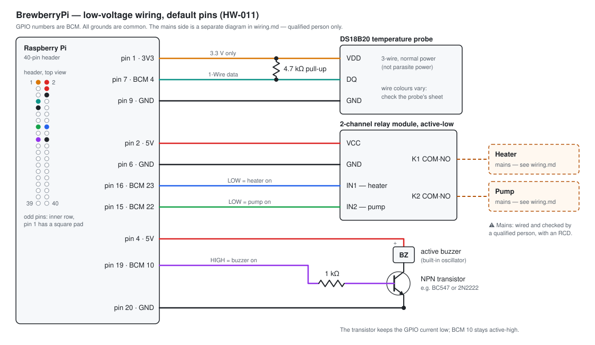
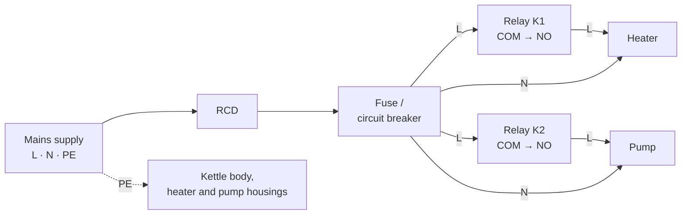

# Wiring guide

How to connect the kettle hardware to the Raspberry Pi with the **default pins** (`HW-011`,
[config.example.json](../specification/data/config.example.json)). GPIO numbers are BCM numbers.

This guide is for building the hardware. Where it shows pin numbers or active levels, the specification
([06-hardware-abstraction.md](../specification/06-hardware-abstraction.md)) is the source of truth.
The resistor values, driver circuits and part examples here are common practice. The specification does not
define them.

## Safety

- The heater and the pump run on **mains power**. The mains side must be wired and checked by a qualified
  person, with a residual-current device (RCD) in the circuit. This guide shows the mains side only as a
  block diagram.
- Keep the mains wiring and the low-voltage wiring apart (separate enclosure or a separate, covered
  compartment). Never touch the relay board's contact side while it is connected to mains.
- Run the [hardware test protocol](../deployment/hardware-test-protocol.md) before the first brew.

## Parts

| Part | Notes |
|---|---|
| Raspberry Pi 3, 4 or 5 (`NFR-050`) | With its own power supply. All three have the same 40-pin header. |
| DS18B20 waterproof probe, 3-wire | Normal power (VDD connected), not parasite power. |
| 4.7 kΩ resistor | 1-Wire pull-up between DQ and 3.3 V. |
| 2-channel relay module, **active-low** ("low-level trigger") | The inputs must switch reliably with 3.3 V logic. The contacts must be rated for the heater and pump current (see [Relay module](#relay-module)). |
| Active buzzer, 5 V | "Active" means it has a built-in oscillator: it sounds when DC is applied. BrewberryPi only switches the pin on and off, so a passive buzzer would only click. |
| NPN transistor (e.g. BC547 or 2N2222) and 1 kΩ resistor | Buzzer driver, keeps the GPIO current low. |

## Low-voltage wiring

| Header pin | Signal | Connect to | Active level (`HW-011`) |
|---|---|---|---|
| 1 | 3.3 V | DS18B20 VDD, and one end of the 4.7 kΩ pull-up | – |
| 7 | BCM 4 (1-Wire) | DS18B20 DQ, and the other end of the 4.7 kΩ pull-up | – |
| 9 | GND | DS18B20 GND | – |
| 2 | 5 V | Relay module VCC | – |
| 6 | GND | Relay module GND | – |
| 16 | BCM 23 | Relay module IN1 (heater) | low = on, HIGH = off |
| 15 | BCM 22 | Relay module IN2 (pump) | low = on, HIGH = off |
| 4 | 5 V | Buzzer + | – |
| 19 | BCM 10 | 1 kΩ resistor → NPN base | high = on, LOW = off |
| 20 | GND | NPN emitter | – |

The buzzer's − terminal goes to the NPN collector. All grounds are common. Pin 1 of the header has a square
solder pad; the odd pins are in the row away from the board edge.

### Temperature probe

- Probe wire colours differ between sellers (often red = VDD, black = GND, yellow or white = DQ). Check the
  data sheet that came with the probe.
- Never connect the probe or the pull-up to 5 V: the Pi's GPIO pins take 3.3 V only.
- BrewberryPi uses the first sensor it finds (`HW-013`, `sensorId: "auto"`). With more than one probe on the
  bus, set `hardware.sensor.sensorId`.

### Relay module

- The relays are **active-low** (`HW-011`): the pin LOW switches the relay on, HIGH switches it off. This
  matches modules sold as "low-level trigger".
- Most of these modules are built for 5 V logic. If a relay does not release when its pin is HIGH (test
  `H-04` in the hardware test protocol), the module's inputs do not work with 3.3 V. On modules with a
  `JD-VCC` jumper: remove the jumper, power `JD-VCC` from 5 V and `VCC` from 3.3 V (header pin 17).
- The contact rating must be higher than the current of the load, with margin. A 3 kW heater on 230 V draws
  about 13 A, which is more than many 10 A relay modules allow. In that case the relay module must switch a
  contactor or a suitable solid-state relay instead of the heater itself.
- The heater uses a normal (mechanical) relay (`Q-26`). In the duty cycle (`CTL-042`) it switches on and off
  at partial power, for example at 50 % within 3 K below the target and during the boil (`CTL-012`). To
  reduce relay wear, no phase is shorter than 10 s (10 s on + 10 s off at 50 %, `hardware.heating.minPhaseMilliseconds`).
  The legacy software used 0.5 s (`FIX-26`). Pick a relay with a long electrical life at the heater's load.
- Power-on window: for a few seconds after the Pi is powered on, before the firmware applies its pin
  settings, the relay pins are pulled low. Low is the "on" level. Whether a relay actually switches depends on
  the module. This is an accepted limitation (`Q-18`); the hardware test protocol measures it.

### Buzzer

- The NPN transistor works as a low-side switch: BCM 10 HIGH switches the transistor and the buzzer on, so
  the buzzer stays active-high as `HW-011` requires.
- A ready-made buzzer module with its own transistor also works, but only if it is active-high
  ("high-level trigger"). Connect its signal input to BCM 10 directly.
- BCM 10 is also the SPI0 MOSI pin. BrewberryPi OS keeps SPI disabled for this reason.

## Mains side (block diagram)

- Each relay switches the **live** conductor (L) through its normally open contact (COM → NO). A relay that
  is not energised, or a Pi that is switched off, then leaves the heater and the pump off.
- Neutral (N) and protective earth (PE) are not switched. All metal parts (kettle, heater, pump housing) are
  connected to PE.
- The Raspberry Pi has its own low-voltage power supply. Mains never reaches the Pi's side of the relay board.

## Operating system settings

BrewberryPi OS sets these up (see the [runtime contract](../deployment/runtime-contract.md)); on a
self-installed system they are needed in `config.txt`:

- `dtoverlay=w1-gpio` — 1-Wire on BCM 4, the default data pin;
- SPI disabled, because BCM 10 is the buzzer;
- the relay pins set to output, HIGH (off), as early as possible during boot.

## Checking the wiring

- `brewberrypi-gpio-test` (`TOOL-002`) switches heater, pump and buzzer in turn every 2 seconds, and prints
  each step with its BCM pin.
- `brewberrypi-sensor-test` (`TOOL-003`) prints the probe temperature about once per second.
- The [hardware test protocol](../deployment/hardware-test-protocol.md) lists every check with its expected
  result.

## Other pins

The pins and active levels can be changed in the configuration file (`hardware.heating`, `hardware.pump`,
`hardware.buzzer`: `pin`, `activeLow`; `HW-010`, `HW-012`). Do not use BCM 4, which is the 1-Wire pin. The
diagram above shows the defaults only.
