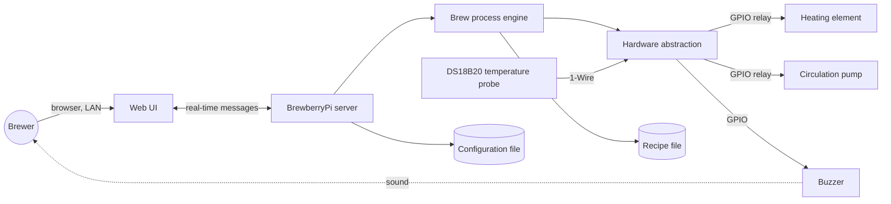

# 01 — Overview

## 1.1 Purpose

BrewberryPi is a **home-brewing mash controller** running on a Raspberry Pi.
It automates the temperature-controlled part of beer brewing (mashing and
boiling) in a single electrically heated kettle with a circulation pump and a
temperature probe.

The operator selects a **recipe** in a web browser. A recipe is an ordered list
of **goals** (e.g. *heat up to 62 °C*, *rest at 62 °C for 30 min*, *mash in now*,
*do the iodine test*). The system executes the goals one after another, switching
heater and pump automatically, and asks the operator for manual actions
(pour in water, mash in, iodine test, lautering) through the web UI and an
audible buzzer.

## 1.2 Scope

In scope:

- `OV-001` Automatic temperature control of a kettle (heat up, hold temperature for a time range, boil).
- `OV-002` Step-wise execution of a recipe (ordered goals) with visible progress.
- `OV-003` Operator interaction: confirmations and yes/no decisions requested by goals, with audible reminders.
- `OV-004` Live web UI: hardware status, temperature chart, process progress, recipe selection, process commands.
- `OV-005` Simulation mode without Raspberry Pi hardware (simulated kettle physics).
- `OV-006` Auxiliary command-line tools for hardware checks and temperature logging (see [12](12-auxiliary-tools.md)).
- `OV-007` Hardware wiring (pins, relay polarity, sensor) is configurable. `[NEW]`

Out of scope (not present in the legacy system; see [13](13-open-questions.md) for candidates):

- User accounts, authentication, remote (internet) access.
- Recipe editing in the UI (recipes are maintained as a file, see [07](07-recipes.md)).
- Persistence of brew history / logs beyond the auxiliary temperature logger.
- Multiple kettles, multiple temperature sensors, fermentation control.

## 1.3 Actors

| Actor | Description |
|-------|-------------|
| **Brewer (operator)** | Uses the web UI on a phone/tablet/PC in the local network. Performs manual steps (water, malt, iodine test, lautering) and answers requests. Hears the buzzer. |
| **Maintainer** | Installs the system on the Pi, edits configuration and recipe file, runs the auxiliary tools. |

## 1.4 System context

- Exactly **one** kettle, **one** heater, **one** pump, **one** buzzer, **one** temperature sensor.
- Any number of browsers may be connected at the same time; they all see the same state and may all issue commands (no locking, no authentication — same as legacy).

## 1.5 Main use case (happy path)

1. Brewer opens the web UI. Hardware status and temperature chart update live.
2. Brewer chooses **Load Process → *recipe***. The goal list of the recipe appears.
3. Brewer presses **Start Process**.
4. The system works through the goals:
   - *Add Water* → buzzer reminder, brewer confirms after pouring in water.
   - *Heat Up* → heater and pump on until target temperature reached.
   - *Mash In* → buzzer reminder, brewer confirms after adding the malt.
   - *Heat Up* / *Rest* pairs → reach temperature, then hold it for N minutes.
   - *Iodine Test* → brewer answers *Yes* (conversion complete) or *No* (additional rest of N minutes, then ask again).
   - *Heat Up* for lautering / *Lautering* → everything off, brewer confirms.
5. Each finished goal is signalled by a short beep. After the last goal all actuators are switched off.

## 1.6 Glossary

| Term | Meaning |
|------|---------|
| **Mash / mashing** | Soaking crushed malt in hot water at defined temperatures to convert starch to sugar. |
| **Rest (Rast)** | Holding the mash at a temperature for a time. German names in recipes: *Eiweißrast* (protein rest), *Maltoserast* (maltose rest), *Verzuckerungsrast* (saccharification rest). |
| **Mash in (Einmaischen)** | Adding the malt to the pre-heated water. |
| **Iodine test (Jodprobe)** | Manual test whether starch conversion is complete. |
| **Lautering (Läutern)** | Separating the wort from the spent grain. |
| **Hops cooking / boil (Würzekochen)** | Boiling the wort with hops (~100 °C). |
| **Recipe** | Static definition: ID, name, ordered list of goal definitions. |
| **Brew process** | A runtime instance of a recipe loaded into the engine, with state per goal. |
| **Goal** | One step of a brew process. Has a state `Waiting` → `Active` → `Done`. |
| **Operator request** | A question a goal asks the brewer (confirmation or yes/no). |
| **Heating power** | Value 0.0…1.0. 0 = off, 1 = full on, in between = duty cycle (time-proportional switching). |
| **Hysteresis** | Switching threshold offset that prevents rapid toggling of the heater around the target temperature. |
| **Tick** | One iteration of the engine loop (every 500 ms). |
| **HAL** | Hardware abstraction layer. |
