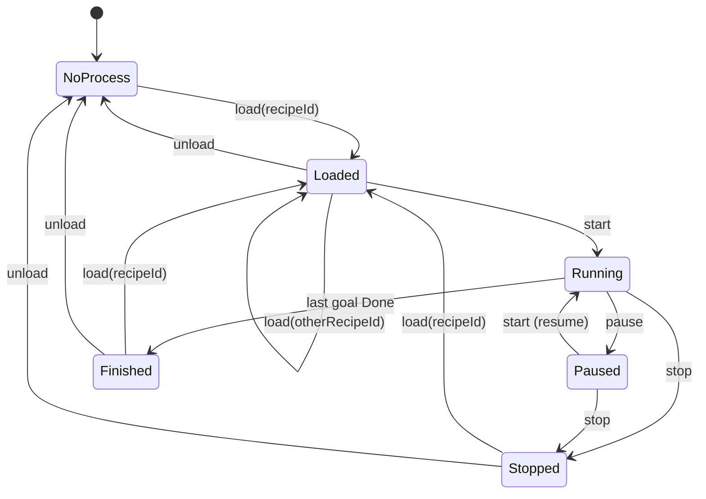

# 03 — Brew Process Engine

The engine holds **at most one** brew process, executes its goals sequentially
and controls the hardware through the HAL ([06](06-hardware-abstraction.md)).

## 3.1 Process lifecycle `[FIX-04..09, FIX-20]`

The legacy engine had no explicit state (it crashed or misbehaved on commands
in the wrong order). The following state machine formalises the legacy happy
path and defines the missing cases.



- `ENG-001` Engine state is `NoProcess` when no process is loaded; otherwise it is the `state` of the loaded process (`Loaded`, `Running`, `Paused`, `Stopped`, `Finished`).
- `ENG-002` The engine state and the loaded process (with all goal data) MUST be observable by clients at any time (see `IF-020`).

## 3.2 Commands

All commands are sent by clients ([08](08-client-server-interface.md)). Every
command is answered with a **reply** `{ success: bool, message: string }` to the
sending client. `[FIX-15]`

### Command acceptance matrix

| State ↓ / Command → | `load(id)` | `unload` | `start` | `pause` | `stop` | `respond(option)` |
|---|---|---|---|---|---|---|
| `NoProcess` | ✅ | ❌ no process | ❌ no process | ❌ | ❌ | ❌ no active request |
| `Loaded` | ✅ replaces | ✅ | ✅ → `Running` | ❌ not running | ❌ not running | ❌ no active request |
| `Running` | ❌ stop first | ❌ stop first | ❌ already running | ✅ → `Paused` | ✅ → `Stopped` | ✅ if request active |
| `Paused` | ❌ stop first | ❌ stop first | ✅ resume → `Running` | ❌ already paused | ✅ → `Stopped` | ✅ if request active |
| `Stopped` | ✅ | ✅ | ❌ load again | ❌ | ❌ | ❌ |
| `Finished` | ✅ | ✅ | ❌ load again | ❌ | ❌ | ❌ |

❌ = rejected: nothing changes, reply `success=false` with a message explaining why
(suggested texts in the cells). Rejections MUST NOT crash or disturb the server.

### Command details

- `ENG-010` **load(recipeId)**
  - Precondition: `recipeId` present and known. Missing parameter → reply `success=false`, `"parameter 'recipe' not set."`. Unknown id → `success=false`, `"Unknown recipe '<id>'."` `[FIX-10]`
  - Effect: replaces any loaded (not running/paused) process with a **fresh** instance of the recipe (`DOM-011`); state `Loaded`; all goals `Waiting`.
  - Reply message (legacy text): `Process <processName> (<processId>) loaded.`
- `ENG-011` **unload** — removes the process; state `NoProcess`; all actuators off; reminder loops stop. Reply `Process unloaded.`
- `ENG-012` **start**
  - From `Loaded`: starts execution at the first goal. Reply `Process started.`
  - From `Paused`: resumes execution with the goal that was active (timers continue where they were frozen, see `ENG-031`). Reply `Process resumed.`
  - At most **one** execution loop exists at any time. `[FIX-05]`
- `ENG-013` **pause** `[FIX-07]` — the execution loop stops calling the active goal; **heating off and pump off**; reminder beeps are silenced; the active request (if any) stays visible and can still be answered; time-range timers of the active goal are frozen. Reply `Process paused.`
- `ENG-014` **stop** — terminates execution within at most one tick (≤ 500 ms); **all actuators off** (heating 0, pump off); reminder loops stop; the active request is removed; goal states stay as they are (active goal stays `Active`) for display. State `Stopped`. Reply `Process stopped.` `[FIX-06, FIX-12]`
- `ENG-015` **respond(option)** — forwards the answer to the active request of the active goal (`DOM-032`). No process / no active goal / no active request → `success=false`, `"There is no active request to respond to."` Invalid option → `success=false`, `"Response option '<option>' is not valid."` `[FIX-11]`

## 3.3 Execution loop (worker)

- `ENG-020` The execution loop processes the goals **strictly in list order**:

```text
for each goal in process.goals:
    goal.status = Active
    repeat every TICK (500 ms):
        if stop requested        -> exit loop (see ENG-014)
        if paused                -> do not pursue; wait for resume/stop
        try:
            achieved = goal.pursue(hal)          # see 04 / 05
        except error:
            log error (severity high, with goal name)
            hal.setHeating(0)                    # fail-safe   [FIX-22]
            achieved = false                     # retry next tick
    until achieved
    goal.activeRequest = none
    goal.status = Done
    hal.shortBeep()
hal.switchEverythingOff()
process.state = Finished
```

- `ENG-021` Tick period: **500 ms** (config `engine.tickMilliseconds`).
- `ENG-022` The first `pursue` of a goal happens immediately when it becomes `Active` (no initial delay).
- `ENG-023` A goal that throws an error is retried on the next tick indefinitely (legacy behaviour); the error is logged each time. During the failing tick the heater is switched off. `[FIX-22]`
- `ENG-024` After each achieved goal: **short beep** (`HW-040`).
- `ENG-025` After the last goal: all actuators off, state `Finished`. (Legacy: no further beep beyond the short beep of the last goal.)
- `ENG-026` The execution loop runs independently of client connections (closing all browsers does not affect a running process).

## 3.4 Timing semantics during pause `[FIX-07]`

- `ENG-030` Time-range goals (Rest, CookWater, iodine additional time) count only **running** time.
- `ENG-031` On pause, the remaining time is frozen; on resume the countdown continues from the frozen value.
- `ENG-032` The temperature-progress start value (`startTemperature`, `CTL-020`) is **not** reset by pause/resume.

## 3.5 Concurrency

- `ENG-040` Commands arrive concurrently from several clients and concurrently with the execution loop. Command handling and state transitions MUST be serialised (no lost updates, no two loops, no torn reads of process state sent to clients).
- `ENG-041` Hardware state changes (heating/pump) are only issued by the execution loop, by the command handlers `pause`/`stop`/`unload`, by the fail-safe rules in [06](06-hardware-abstraction.md), and at startup/shutdown.
